# Venture Intelligence v0.5: engineering brief

## Scope
Evidence-first, explicitly bounded software for pre-review of **fictional** startup PDFs. This is not an HTGF product or an investment recommendation system.

## Runtime architecture

```mermaid
flowchart LR
  Input[PDF / fictional pitch] --> API[FastAPI input validation]
  API --> Graph[LangGraph StateGraph or explicit local runner]
  Graph --> Ingest[1. Ingest PyMuPDF]
  Ingest --> Extract[2. Conservative field extraction]
  Extract --> Gate[3. Hard verification gate]
  Gate --> Human[4. Human-review checkpoint]
  Human --> Store[(Local SQLite)]
  Store --> UI[Standalone browser analyst workspace]
  UI --> Trace[Inspect trace + citations + evaluation]
```

Nodes are in `backend/app/workflow.py`. Both engines run the **same node functions**: `ingest`, `extract`, `verify`, `review_checkpoint`. Selecting `VI_WORKFLOW_ENGINE=langgraph` forces a real LangGraph import and fails loudly if it is missing; `auto` transparently reports `local-sequential` otherwise. This matters: sequential node execution is not falsely marketed as LangGraph.

## Source of truth
Each source ID (`p2-l10`) contains a line actually read from the supplied PDF's searchable text layer, not a language-model-generated citation. Supported facts must link to existing IDs and their values must occur verbatim in linked lines. Contradictions have no accepted value and preserve both line references. This proves the document said something, not that the claim is true.

## Human control
A workflow finishes in a `pending` state. An analyst must explicitly mark `reviewed`; this records review activity only and must not be interpreted as due diligence or an approval. There is **no automatic investment ranking, financing decision or contact to a founder**.

## Observability
`GET /api/deals/{id}/trace` returns locally persisted stage names, elapsed milliseconds and counts. It never needs a third-party service. `backend/app/observability.py` provides an *optional, unverified in this environment* Langfuse v3 integration behind `VI_LANGFUSE_ENABLED=1`; it emits stage metadata/counts, never source text, filename, prompts or extracted personal data. Do not enable remote telemetry for confidential investor documents.

## Baseline comparison and honesty
Synthetic cohort: 30 PDFs, 17 labelled fields each. v0.3 extracted 505/510. v0.5 extracts 510/510 because we explicitly added the previously missed `Founding crew ·` pattern. **This is in-sample improvement after inspecting errors**, not predictive accuracy. Five conflicting-traction cases continue to abstain. The next meaningful exercise is a completely untouched, human-labelled evaluation sample with diverse layouts and OCR scans.

## Threat model and limits
Not production-ready. No authentication, tenancy, malware scanning, encryption-at-rest, audit retention policy, file isolation or OCR. The default stand-alone app uses local SQLite and should bind to `127.0.0.1` only. Do NOT deploy PDF upload routes publicly. The public GitHub Pages website is a separate static interaction with synthetic, precomputed data; it is not this backend.
